<!-- ════════════════════════════════════════════════════════════════ -->
<!-- NitaxIso · LÊ CÔNG LUYẾN · Information Assurance                 -->
<!-- Theme: NEON CYBERDECK · terminal aesthetic                       -->
<!-- ════════════════════════════════════════════════════════════════ -->

  

 

  

 

  

 

  

 

<!-- ─── TELEMETRY / DETECTION RADAR ────────────────────────────── -->

  

 

<!-- ─── STATS ──────────────────────────────────────────────────── -->

  

 

<!-- ─── CONTRIBUTION STREAM ────────────────────────────────────── -->

  <code>NitaxIso@sec:~$ ./snake.sh --eat-contributions</code>

 

  

 

<!-- ─── CONNECT ────────────────────────────────────────────────── -->

  <code>NitaxIso@sec:~$ ./connect.sh</code>

 

  
  
  
  
    
  

 

  

